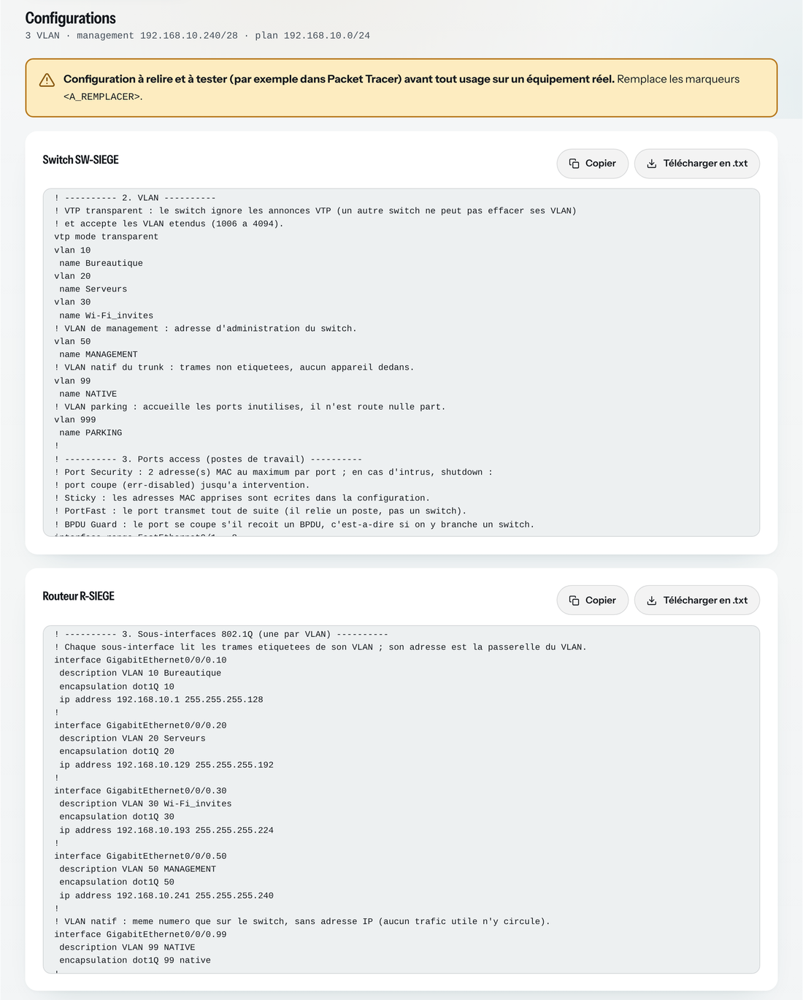
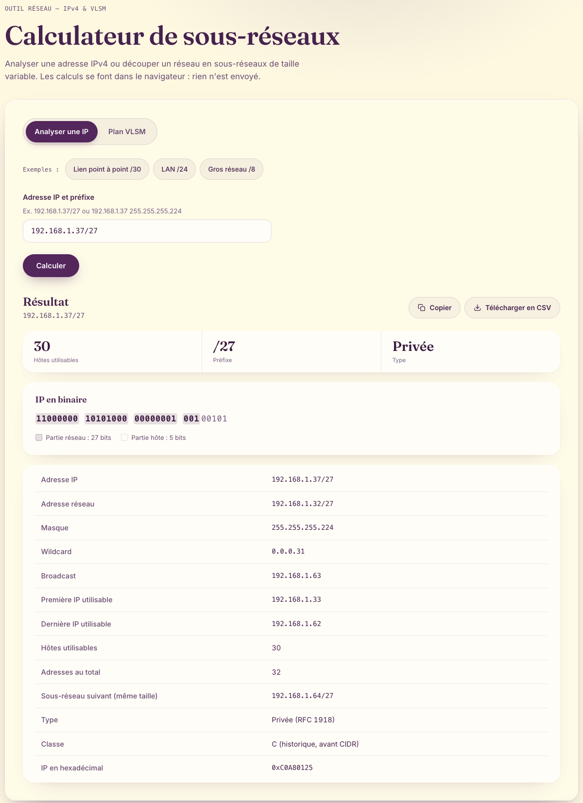
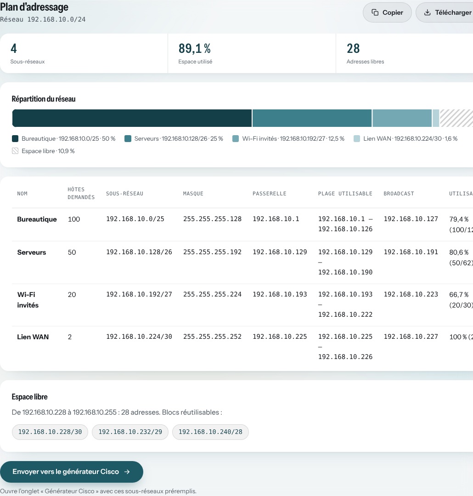
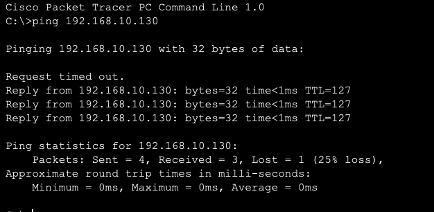

# net-toolkit

[](https://github.com/angele-os/net-toolkit/actions/workflows/tests.yml)
[](https://github.com/angele-os/net-toolkit/actions/workflows/deploy.yml)

[Français](#français) · [English](#english)

## Français

Calculateur IPv4 et VLSM qui fonctionne entièrement dans le navigateur : analyser une adresse, découper un réseau en sous-réseaux dimensionnés selon chaque besoin, puis générer la configuration Cisco du switch et du routeur correspondants.

**Démo : <https://reseau.ange-bonkoski.fr>**

HTML, CSS et JavaScript sans framework, sans dépendance npm.



### En bref

- **Du besoin à la configuration** : une liste de besoins (« 100 postes en bureautique, 50 serveurs… ») devient un plan d'adressage VLSM, puis les configurations IOS commentées d'un switch Catalyst 2960 et d'un routeur ISR 4321.
- **Validé dans Packet Tracer** : trunk 802.1Q, un bail DHCP dans chaque VLAN et ping entre VLAN à travers le routeur. La maquette `.pkt` est fournie.
- **Sécurisé par conception** : configurations durcies par défaut (SSH v2, Port Security, BPDU Guard, ports inutilisés coupés), aucun mot de passe demandé, saisies vérifiées par liste blanche contre l'injection de commandes.
- **Fiable** : 224 tests automatisés, publication uniquement si tous passent, aucune dépendance.

### Pourquoi ce projet

En TP de réseau, une erreur de calcul VLSM ou une faute de frappe dans une configuration de switch fait perdre beaucoup de temps. J'ai voulu un outil qui fasse le calcul juste, explique chaque résultat, et produise une configuration déjà durcie, que je peux tester dans Packet Tracer avant de la taper sur un vrai équipement.

### Fonctionnalités

#### Analyse d'une adresse IPv4

- Saisie en notation CIDR (`192.168.1.37/27`) ou avec un masque (`192.168.1.37 255.255.255.224`) ; les masques non contigus sont refusés.
- Adresse réseau, broadcast, masque, masque inverse (wildcard), première et dernière adresses utilisables, nombre d'hôtes utilisables et nombre total d'adresses.
- Cas particuliers pris en charge : /31 (liaison point à point, RFC 3021) et /32 (hôte unique).
- Sous-réseau suivant de même taille.
- Type d'adresse (privée RFC 1918, publique, loopback, lien local, multicast, réservée) et classe historique (A à E).
- Représentation binaire, avec les bits réseau mis en évidence, et hexadécimale.



#### Plan d'adressage VLSM

- Un réseau de départ et une liste de besoins (nom et nombre d'hôtes), jusqu'à 256 sous-réseaux.
- Pour chaque sous-réseau : adresse CIDR, masque, passerelle (première adresse utilisable), plage utilisable, broadcast et taux d'utilisation.
- Barre de répartition visuelle du réseau de départ.
- Espace restant découpé en blocs CIDR réutilisables.
- Messages d'erreur explicites : réseau de départ mal aligné (avec l'adresse correcte suggérée), plan trop grand (avec le nombre d'adresses manquantes).



#### Générateur Cisco

À partir du plan VLSM (bouton « Envoyer vers le générateur Cisco »), l'outil produit deux configurations IOS commentées : celle du switch et celle du routeur.

**Modèles ciblés**

- Switch **Cisco Catalyst 2960-24TT** (Fa0/1 à Fa0/24, Gi0/1 et Gi0/2).
- Routeur **Cisco ISR 4321**, relié au switch par un trunk sur G0/0/0. Le routage entre VLAN passe par des sous-interfaces (*router-on-a-stick*).
- Syntaxe IOS 15. Les commandes sont choisies pour être acceptées par Cisco Packet Tracer ; les variantes qu'il ne connaît pas sont signalées en commentaire.

**Contenu des configurations**

- **Switch** :
  - durcissement de base : SSH v2 seul sur les lignes VTY, `exec-timeout`, `service password-encryption`, bannière ;
  - VLAN ;
  - ports access avec Port Security, PortFast et BPDU Guard ;
  - trunk 802.1Q : `nonegotiate`, VLAN natif dédié, liste des VLAN autorisés ;
  - ports inutilisés coupés et rangés dans un VLAN parking ;
  - Rapid PVST+ ;
  - interface de management et passerelle par défaut.
- **Routeur** :
  - même durcissement ;
  - une sous-interface 802.1Q par VLAN, et le VLAN natif sans adresse ;
  - DHCP : passerelles exclues, puis un pool par VLAN avec passerelle et serveur DNS.

**Dans l'interface**

- Une ligne par sous-réseau :
  - case « Créer un VLAN » (les /30, liens point à point, sont décochés au départ) ;
  - numéro (10, 20, 30… par défaut) ;
  - nom proposé sans accent ;
  - plage de ports access.
- Les réglages : hostnames, port trunk, VLAN natif, VLAN de management (proposé dans le plus grand bloc libre du plan), Port Security, DNS et bannière.
- Chaque erreur s'affiche sous le champ concerné, avec un message clair.
- Chaque configuration se copie ou se télécharge en `.txt`.

**Sécurité** : chaque champ texte est vérifié par liste blanche. On ne peut donc pas injecter de commande dans la configuration, par exemple avec un retour à la ligne dans un nom de VLAN. **Aucun mot de passe n'est demandé** : chaque secret est un marqueur `<A_REMPLACER>` à remplir à la main. Les détails sont dans [SECURITY.md](SECURITY.md).

> **Configuration à relire et à tester (par exemple dans Packet Tracer) avant tout usage sur un équipement réel.** Collée sans remplacer les marqueurs, elle fonctionne, mais avec un mot de passe public.

**Test dans Packet Tracer** avec le plan d'exemple (Bureautique, Serveurs, Wi-Fi invités, et un VLAN de management en 192.168.10.240/28) :
- trunk actif avec le VLAN natif 99 ;
- un bail DHCP dans chaque VLAN ;
- ping d'un VLAN à l'autre à travers le routeur.



Le premier paquet perdu correspond à la résolution ARP. Le TTL de 127 (128 − 1) montre que le paquet a traversé le routeur.

**Maquette Packet Tracer** : [docs/packet-tracer/net-toolkit-siege.pkt](docs/packet-tracer/net-toolkit-siege.pkt). Elle contient le switch 2960-24TT, le routeur ISR 4321 et les PC des VLAN 10, 20 et 30, configurés avec les fichiers générés. Elle s'ouvre avec Cisco Packet Tracer 8.2 ou une version plus récente.

#### Export et utilisation

- Copie des résultats en un clic, prête à coller dans un tableur.
- Téléchargement CSV (séparateur `;`, compatible avec Excel en français), protégé contre l'injection de formules.
- Mise en page dédiée à l'impression (A4 paysage, résultats seuls).
- Interface en français, adaptée au mobile, conçue pour la navigation au clavier et les lecteurs d'écran.
- Aucune donnée envoyée ni stockée : pas de serveur, pas de cookie, pas de stockage local.

### Comment fonctionne l'algorithme VLSM

VLSM (*Variable Length Subnet Mask*, masque de longueur variable) attribue à chaque sous-réseau un masque adapté à sa taille, au lieu de découper le réseau en parts égales. On gaspille ainsi beaucoup moins d'adresses.

Exemple : le réseau `192.168.10.0/24` (256 adresses) d'une petite entreprise, avec quatre besoins.

1. **Taille de chaque bloc.** Un sous-réseau contient toujours une puissance de 2 d'adresses, dont deux sont réservées : l'adresse réseau et le broadcast. On retient donc la plus petite puissance de 2 supérieure ou égale à « hôtes + 2 ». Pour 100 hôtes : 102 adresses nécessaires, donc un bloc de 128, soit un /25.
2. **Vérification.** On additionne les blocs : 128 + 64 + 32 + 4 = 228 adresses, ce qui tient dans les 256 disponibles. Dans le cas contraire, l'outil indique combien d'adresses manquent.
3. **Tri du plus grand au plus petit.** Un bloc de 128 adresses doit commencer sur un multiple de 128 (c'est l'alignement). En plaçant les plus grands blocs d'abord, chaque bloc suivant tombe naturellement sur une frontière valide, sans laisser de trou.
4. **Placement.** Les blocs sont posés les uns à la suite des autres depuis le début du réseau.
5. **Espace libre.** Les adresses restantes sont découpées en blocs CIDR alignés, les plus grands possible, réutilisables pour de futurs besoins.

Résultat :

| Besoin | Hôtes demandés | Sous-réseau | Plage utilisable | Broadcast | Utilisation |
|---|---:|---|---|---|---:|
| Bureautique | 100 | 192.168.10.0/25 | .1 à .126 | .127 | 79,4 % |
| Serveurs | 50 | 192.168.10.128/26 | .129 à .190 | .191 | 80,6 % |
| Wi-Fi invités | 20 | 192.168.10.192/27 | .193 à .222 | .223 | 66,7 % |
| Lien WAN | 2 | 192.168.10.224/30 | .225 à .226 | .227 | 100 % |

Espace libre : 28 adresses, de `192.168.10.228` à `192.168.10.255`, soit les blocs `192.168.10.228/30`, `192.168.10.232/29` et `192.168.10.240/28`.

C'est ce plan qui apparaît sur la [capture du plan VLSM](docs/capture-vlsm.png) ci-dessus.

### Lancer les tests en local

Prérequis : Node.js 24 ou plus récent. Aucune dépendance à installer : les tests utilisent `node:test`, le lanceur de tests intégré à Node.js.

```sh
git clone https://github.com/angele-os/net-toolkit.git
cd net-toolkit
npm test            # lance tous les tests
npm run coverage    # idem, avec le taux de couverture du code
```

Les tests couvrent :
- les calculs (`js/ip.js`, `js/vlsm.js`) ;
- le générateur Cisco (`js/cisco.js`) : une configuration de référence comparée à des fichiers attendus dans `tests/fixtures/`, chaque cas d'erreur et 24 tentatives d'injection de commandes ;
- l'export (`js/export.js`) ;
- des règles de sécurité vérifiées automatiquement sur le HTML (CSP, absence de script en ligne, aucun `innerHTML`, `maxlength` égaux aux limites du code) et sur les workflows (actions épinglées par SHA). Ils s'exécutent à chaque push et à chaque pull request ; le site n'est publié que s'ils réussissent.

### Sécurité

net-toolkit est une page statique : pas de serveur, pas de base de données, pas de compte, et les saisies ne quittent jamais le navigateur. Les protections mises en place (CSP stricte avec Trusted Types, insertion du texte sans interprétation HTML, protection des exports CSV, listes blanches contre l'injection de commandes dans la configuration Cisco, aucun mot de passe demandé, limites de saisie, aucune dépendance, publication par liste blanche) sont détaillées avec le modèle de menace dans [SECURITY.md](SECURITY.md). Pour signaler une faille, merci d'utiliser le [signalement privé de GitHub](https://github.com/angele-os/net-toolkit/security/advisories/new) plutôt qu'une issue publique.

### Feuille de route

- **v1.1 (fait)** : générateur de configurations Cisco à partir du plan VLSM.
- **v2** :
  - **switch de niveau 3** (par exemple un Catalyst 3650) : routage entre VLAN par interfaces VLAN (SVI) et `ip routing`, à la place du *router-on-a-stick* ;
  - **plusieurs switchs** : trunks entre switchs, choix du pont racine Spanning Tree, ports access répartis sur plusieurs équipements ;
  - **IPv6** : plan d'adressage IPv6 et configuration double pile (IPv4 et IPv6).

### Licence

Code distribué sous licence MIT : voir [LICENSE](LICENSE). La police Instrument Sans, auto-hébergée dans `fonts/`, est distribuée sous SIL Open Font License 1.1 : voir [fonts/README.md](fonts/README.md).

---

## English

IPv4 and VLSM calculator that runs entirely in the browser: analyse an address, split a network into subnets sized for each requirement, then generate the Cisco configuration of the matching switch and router.

**Demo: <https://reseau.ange-bonkoski.fr>** (the interface is in French; see the screenshots of the [Cisco generator](docs/capture-cisco.png), the [address analysis](docs/capture-ip.png), the [VLSM plan](docs/capture-vlsm.png) and the [Packet Tracer test](docs/cisco-ping.png)).

Plain HTML, CSS and JavaScript: no framework, no npm dependencies.

### At a glance

- **From requirements to configuration**: a list of needs ("100 office hosts, 50 servers…") becomes a VLSM addressing plan, then the commented IOS configurations of a Catalyst 2960 switch and an ISR 4321 router.
- **Validated in Packet Tracer**: 802.1Q trunk, one DHCP lease per VLAN and inter-VLAN ping through the router. The `.pkt` lab is included.
- **Secure by design**: hardened defaults (SSH v2, Port Security, BPDU Guard, unused ports shut down), no password ever requested, allow-listed input against command injection.
- **Reliable**: 224 automated tests, deployment only when they all pass, zero dependencies.

### Features

#### IPv4 address analysis

- Input in CIDR notation (`192.168.1.37/27`) or with a subnet mask (`192.168.1.37 255.255.255.224`); non-contiguous masks are rejected.
- Network address, broadcast, subnet mask, wildcard mask, first and last usable addresses, number of usable hosts and total addresses.
- Edge cases handled: /31 (point-to-point link, RFC 3021) and /32 (single host).
- Next subnet of the same size.
- Address type (private RFC 1918, public, loopback, link-local, multicast, reserved) and historical class (A to E).
- Binary representation, with network bits highlighted, and hexadecimal.

#### VLSM addressing plan

- A starting network and a list of requirements (name and number of hosts), up to 256 subnets.
- For each subnet: CIDR address, mask, gateway (first usable address), usable range, broadcast and utilisation rate.
- Visual allocation bar of the starting network.
- Remaining space split into reusable CIDR blocks.
- Clear error messages: misaligned starting network (with the correct address suggested), plan too large (with the number of missing addresses).

#### Cisco generator

From the VLSM plan ("Envoyer vers le générateur Cisco" button), the tool produces two commented IOS configurations: one for the switch, one for the router.

**Target models**

- **Cisco Catalyst 2960-24TT** switch (Fa0/1 to Fa0/24, Gi0/1 and Gi0/2).
- **Cisco ISR 4321** router, connected to the switch through a trunk on G0/0/0. Inter-VLAN routing uses subinterfaces (router-on-a-stick).
- IOS 15 syntax. Commands are chosen to be accepted by Cisco Packet Tracer; variants it does not support are flagged in comments.

**What the configurations contain**

- **Switch**:
  - baseline hardening: SSH v2 only on VTY lines, `exec-timeout`, `service password-encryption`, banner;
  - VLANs;
  - access ports with Port Security, PortFast and BPDU Guard;
  - 802.1Q trunk: `nonegotiate`, dedicated native VLAN, allowed VLAN list;
  - unused ports shut down and moved to a parking VLAN;
  - Rapid PVST+;
  - management interface and default gateway.
- **Router**:
  - the same hardening;
  - one 802.1Q subinterface per VLAN, and the native VLAN without an address;
  - DHCP: gateways excluded, then one pool per VLAN with gateway and DNS server.

**In the interface**

- One row per subnet:
  - "Create a VLAN" checkbox (/30 point-to-point links start unchecked);
  - VLAN ID (10, 20, 30… by default);
  - suggested name without accents;
  - access port range.
- The settings: hostnames, trunk port, native VLAN, management VLAN (suggested in the largest free block of the plan), Port Security, DNS and banner.
- Each error is shown under the field it concerns, with a clear message.
- Each configuration can be copied or downloaded as `.txt`.

**Security**: every text field is checked against an allow-list, so no command can be injected into the configuration (for example through a line break in a VLAN name). **No password is ever requested**: each secret is a `<A_REMPLACER>` placeholder to fill in by hand. Details in [SECURITY.md](SECURITY.md).

> **Review and test the configuration (for example in Packet Tracer) before any use on real equipment.** If it is pasted without replacing the placeholders, it works, but with a public password.

**Tested in Packet Tracer** with the sample plan (Office, Servers, Guest Wi-Fi, and a management VLAN in 192.168.10.240/28):
- trunk up with native VLAN 99;
- one DHCP lease in each VLAN;
- ping from one VLAN to another through the router.

The first lost packet is ARP resolution; the TTL of 127 (128 − 1) shows the packet went through the router.

**Packet Tracer lab**: [docs/packet-tracer/net-toolkit-siege.pkt](docs/packet-tracer/net-toolkit-siege.pkt). It contains the 2960-24TT switch, the ISR 4321 router and the PCs of VLANs 10, 20 and 30, configured with the generated files. It opens in Cisco Packet Tracer 8.2 or later.

#### Export and usability

- One-click copy of the results, ready to paste into a spreadsheet.
- CSV download (`;` separator, compatible with French-locale Excel), protected against formula injection.
- Dedicated print layout (A4 landscape, results only).
- French interface, mobile-friendly, designed for keyboard navigation and screen readers.
- No data sent or stored: no server, no cookies, no local storage.

### How the VLSM algorithm works

VLSM (Variable Length Subnet Mask) gives each subnet a mask suited to its size instead of splitting the network into equal parts, which wastes far fewer addresses.

Example: a small company's `192.168.10.0/24` network (256 addresses) with four requirements.

1. **Block size.** A subnet always holds a power of 2 addresses, two of which are reserved: the network address and the broadcast. The tool therefore picks the smallest power of 2 greater than or equal to "hosts + 2". For 100 hosts: 102 addresses needed, so a 128-address block, i.e. a /25.
2. **Check.** The blocks add up to 128 + 64 + 32 + 4 = 228 addresses, which fits in the 256 available. Otherwise, the tool reports how many addresses are missing.
3. **Sort from largest to smallest.** A 128-address block must start on a multiple of 128 (alignment). Placing the largest blocks first guarantees that each following block lands on a valid boundary, with no gaps.
4. **Placement.** Blocks are laid out one after another from the start of the network.
5. **Free space.** The remaining addresses are split into the largest possible aligned CIDR blocks, available for future needs.

Result:

| Requirement | Requested hosts | Subnet | Usable range | Broadcast | Utilisation |
|---|---:|---|---|---|---:|
| Office | 100 | 192.168.10.0/25 | .1 to .126 | .127 | 79.4% |
| Servers | 50 | 192.168.10.128/26 | .129 to .190 | .191 | 80.6% |
| Guest Wi-Fi | 20 | 192.168.10.192/27 | .193 to .222 | .223 | 66.7% |
| WAN link | 2 | 192.168.10.224/30 | .225 to .226 | .227 | 100% |

Free space: 28 addresses, from `192.168.10.228` to `192.168.10.255`, i.e. blocks `192.168.10.228/30`, `192.168.10.232/29` and `192.168.10.240/28`.

This is the plan shown in the [VLSM screenshot](docs/capture-vlsm.png).

### Running the tests locally

Requirement: Node.js 24 or later. Nothing to install: the tests use `node:test`, the test runner built into Node.js.

```sh
git clone https://github.com/angele-os/net-toolkit.git
cd net-toolkit
npm test            # run all tests
npm run coverage    # same, with code coverage
```

The tests cover:
- the calculations (`js/ip.js`, `js/vlsm.js`);
- the Cisco generator (`js/cisco.js`): a reference configuration compared with expected files in `tests/fixtures/`, every error case, and 24 command-injection attempts;
- the export (`js/export.js`);
- security rules checked automatically against the HTML (CSP, no inline script, no `innerHTML`, `maxlength` values matching the code limits) and the workflows (SHA-pinned actions). They run on every push and pull request; the site is only deployed when they pass.

### Security

net-toolkit is a static page: no server, no database, no account, and input never leaves the browser. The safeguards (strict CSP with Trusted Types, text inserted without HTML interpretation, CSV export protection, allow-lists against command injection into the Cisco configuration, no password requested, input limits, zero dependencies, allow-listed deployment) are documented together with the threat model in [SECURITY.md](SECURITY.md). To report a vulnerability, please use [GitHub private vulnerability reporting](https://github.com/angele-os/net-toolkit/security/advisories/new) rather than a public issue.

### Roadmap

- **v1.1 (done)**: Cisco configuration generator from the VLSM plan.
- **v2**:
  - **Layer 3 switch** (for example a Catalyst 3650): inter-VLAN routing through VLAN interfaces (SVIs) and `ip routing`, instead of router-on-a-stick;
  - **multiple switches**: trunks between switches, Spanning Tree root bridge selection, access ports spread over several devices;
  - **IPv6**: IPv6 addressing plan and dual-stack (IPv4 and IPv6) configuration.

### License

Code released under the MIT License: see [LICENSE](LICENSE). The Instrument Sans font, self-hosted in `fonts/`, is released under the SIL Open Font License 1.1: see [fonts/README.md](fonts/README.md).
